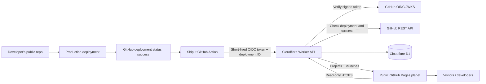
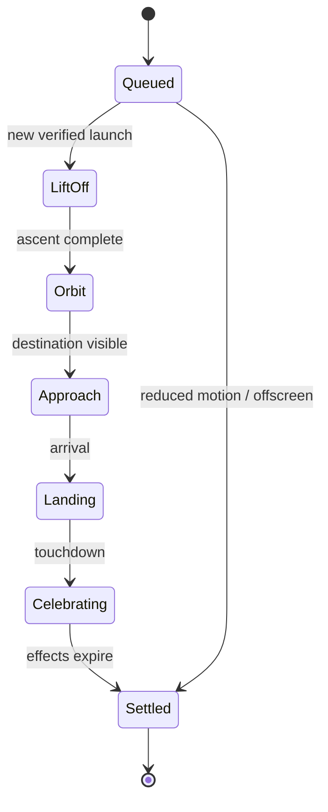

# Ship It — Product & Technical Architecture

**Status:** Implementation handoff / v1 specification  
**Repository:** https://github.com/ndunl075/Ship-It  
**Default branch:** `main`  
**License target:** MIT  
**Principle:** Free, open-source, no paid AI APIs, no paid third-party service requirement.

> **UI HANDOFF — USE ASTRA:** Use **Astra** for the design and implementation of the user-facing interface. Give Astra this entire document as context. Astra owns the interaction design, visual system, 3D planet, rocket motion, animation polish, and responsive UI. This means the Astra AI coding/design workflow, **not** the Astro web framework. The frontend must still adhere to the technical contracts and performance/accessibility requirements below.

## 1. Product

**Ship It turns a successful software deployment into a rocket launch.** A project gets a small, memorable landing spot on a shared public 3D planet, and each later production deployment sends another rocket to the same project site. Anyone can explore the planet, discover shipped projects, watch launches, and share a project or launch URL.

The novelty is the presentation, but the utility is a public, verifiable shipping portfolio and a lightweight way to celebrate real deployments.

### Primary user journey

1. A developer adds the Ship It GitHub Action to a repository that already deploys to production.
2. A production deployment succeeds. Ship It runs **after** success; failure, cancellation, preview builds, and in-progress deployments must not launch rockets.
3. The action obtains a short-lived GitHub Actions OIDC identity token and submits the deployment ID to the Ship It API. Users do not need a Ship It API key.
4. The API independently verifies the public GitHub deployment and its successful status, deduplicates it, and records a launch.
5. Ship It returns a shareable launch URL and prints it in the Actions job summary.
6. The public planet shows an incoming rocket and a persistent marker for the project. Clicking that marker opens its project card, live link, repository, launch history, and share actions.
7. The next successful production deploy adds a new flight to the timeline but reuses the project's landing location.

### v1 features

- Shared, public, browsable planet; no account required to view.
- Polished 3D globe with project landing sites, animated rockets, camera orbit, zoom, and a recent-launch feed.
- One marker per project, with a launch count and drill-down history.
- Verified success indicator meaning **GitHub reported a successful deployment**, not an uptime guarantee.
- Filtering/search by project or GitHub owner, recent launches, and copyable deep links.
- Automatic GitHub Actions integration for public repositories using deployment records.
- Useful empty state and a demo/sandbox launch that is clearly labeled as a simulation.
- Works on mobile; reduced-motion, keyboard navigation, and a non-WebGL fallback.
- Zero mandatory purchase, subscription, account creation on Ship It, or AI inference.

### Out of scope for v1

- Private repository access; arbitrary unverified webhooks; payments; user profiles requiring OAuth; comments; direct messaging; a live multiplayer simulation; mobile apps; AI-generated imagery; global leaderboards; custom domains; native Vercel/Netlify integrations without GitHub deployment records.
- Do **not** claim that every provider's deployment is automatically detectable. v1 requires a public GitHub deployment with a verifiable success status and an integration step.

## 2. Architectural decision: a shared planet, not one planet per repo

One publicly accessible planet hosts all published Ship It projects. Its contents are delivered from a read-only public API; GitHub Actions is the only v1 write path. This preserves a genuinely communal showcase instead of requiring visitors to switch between separate repository Pages sites.

**Selected stack**

| Layer | Technology | Purpose |
| --- | --- | --- |
| Frontend | React + TypeScript + Vite | Static interactive app |
| Globe | Three.js + React Three Fiber + Drei | Lightweight 3D planet and rockets |
| UI state | React state / small dedicated store if needed | Camera, selection, UI panels |
| Styling | CSS variables and modular CSS | Original Astra-designed UI, no mandatory component SaaS |
| Validation | Zod, shared schemas | Strict input/output contracts |
| Backend | Cloudflare Workers (TypeScript) | Public read API and authenticated ingestion |
| Persistence | Cloudflare D1 (SQLite) | Projects, launches, moderation state |
| Website hosting | GitHub Pages, deployed from `main` | Free static hosting for the public repository |
| Integrations | Public GitHub Action; GitHub OIDC and REST Deployments API | Credential-free proof of repository origin and deployment success |
| CI | GitHub Actions | Lint, typecheck, tests, builds, Pages publication |
| Package management | pnpm workspaces | Monorepo without a heavy build platform |

Use the free `github.io/Ship-It/` project-site URL initially; the API may run at a free `workers.dev` address. A custom domain is optional, never a prerequisite. **Free-tier availability has limits** (see `13); never silently enable a paid tier or require a billing upgrade to make the MVP work.

### System diagram



**Trust boundary:** The browser can fetch public data, but can never register a deployment. The action is a public integration client, not a privileged database writer. The Worker verifies GitHub identity **and** deployment success before inserting anything.

## 3. Monorepo layout (target)

```text
Ship-It/
├── ARCHITECTURE.md                # This file: source of truth for v1
├── README.md                      # Quickstart, demo, deploy setup
├── LICENSE                        # MIT
├── action.yml                     # Public GitHub Action entrypoint
├── package.json
├── pnpm-lock.yaml
├── pnpm-workspace.yaml
├── tsconfig.base.json
├── apps/
│   ├── web/
│   │   ├── src/
│   │   │   ├── app/               # App entry, routing, providers
│   │   │   ├── components/        # Astra-built controls and panels
│   │   │   ├── globe/             # Scene, camera, terrain, markers, rockets
│   │   │   ├── features/          # Feed, search, project detail, share
│   │   │   ├── api/               # Typed read-only API client
│   │   │   ├── styles/            # Design tokens, responsive primitives
│   │   │   └── fixtures/          # Deterministic local demo data
│   │   └── vite.config.ts
│   └── api/
│       ├── src/
│       │   ├── index.ts           # Worker router
│       │   ├── routes/            # Public reads / authenticated launches
│       │   ├── auth/              # OIDC signature + claim validation
│       │   ├── github/            # Deployment-status verification
│       │   ├── db/                # Parameterized queries, migrations
│       │   ├── services/          # Launch creation and moderation checks
│       │   └── middleware/        # CORS, limits, errors, caching
│       ├── migrations/
│       │   └── 0001_init.sql
│       └── wrangler.jsonc
├── packages/
│   ├── shared/                    # Zod schemas, public types, geometry seed
│   └── action/                    # Action runner, OIDC, HTTP, job summary
├── .github/
│   ├── workflows/
│   │   ├── ci.yml
│   │   └── deploy-pages.yml
│   └── ISSUE_TEMPLATE/           # Bug reports, abuse/removal requests
├── docs/
│   ├── SETUP.md
│   ├── API.md
│   ├── SECURITY.md
│   └── UI-ASTRA.md
└── scripts/
    └── seed-demo.ts
```

Keep packages independent. The browser must not import Worker internals; share only types, validation, and deterministic pure helpers. Avoid an unnecessary separate auth server, WebSocket service, queue, or job runner for the MVP.

## 4. Domain model and database

**Project** is the persistent landing spot for one GitHub repository. **Launch** is one verified successful production deployment. **Planet** is a visual projection of public projects; it does not need its own database table.

Use immutable GitHub numeric repository IDs for identity, not mutable owner/repo text. Display names and links may be refreshed later. A single project is stable across name changes, and a project may have many launches.

### D1 schema

```sql
CREATE TABLE projects (
  id TEXT PRIMARY KEY,                 -- "gh:<numeric_repository_id>"
  github_repository_id INTEGER NOT NULL UNIQUE,
  github_owner TEXT NOT NULL,
  github_repo TEXT NOT NULL,
  display_name TEXT NOT NULL,
  description TEXT,
  repo_url TEXT NOT NULL,
  homepage_url TEXT,
  first_launched_at TEXT NOT NULL,
  latest_launched_at TEXT NOT NULL,
  status TEXT NOT NULL DEFAULT 'visible'
    CHECK (status IN ('visible', 'hidden')),
  position_lat REAL NOT NULL,
  position_lon REAL NOT NULL,
  created_at TEXT NOT NULL,
  updated_at TEXT NOT NULL
);

CREATE TABLE launches (
  id TEXT PRIMARY KEY,                 -- UUIDv7 or ULID
  project_id TEXT NOT NULL REFERENCES projects(id),
  github_deployment_id INTEGER NOT NULL,
  github_run_id INTEGER,
  commit_sha TEXT NOT NULL,
  environment TEXT NOT NULL,
  target_url TEXT,
  status_url TEXT NOT NULL,
  deployed_at TEXT NOT NULL,
  recorded_at TEXT NOT NULL,
  UNIQUE (project_id, github_deployment_id)
);

CREATE INDEX idx_projects_latest
  ON projects(status, latest_launched_at DESC);
CREATE INDEX idx_launches_recent
  ON launches(recorded_at DESC, id DESC);
CREATE INDEX idx_launches_project
  ON launches(project_id, deployed_at DESC);

CREATE TABLE moderation_audit (
  id TEXT PRIMARY KEY,
  project_id TEXT NOT NULL,
  action TEXT NOT NULL,
  reason TEXT NOT NULL,
  created_at TEXT NOT NULL
);
```

Use UTC ISO-8601 timestamps throughout. D1 migrations are versioned, checked into Git, applied through Wrangler, and never generated dynamically by browser traffic. Keep write operations in an atomic D1 batch/transaction. Enforce the unique deployment constraint at the DB layer; checking duplicates only in application code is insufficient.

For the first release, calculate project launch counts using an indexed aggregate query or a batched count; avoid maintaining an inconsistent second counter. Hidden projects and their launches must be excluded from all public endpoints.

## 5. Verified deployment ingestion

### Supported trigger

**Preferred:** A GitHub workflow handles a `deployment_status` event and invokes the Ship It action only when the status is `success` and the environment is `production`.

**Fallback:** Invoke Ship It as the final step of an existing deployment workflow, after the provider confirms success, and pass a real GitHub deployment ID. Some deployments created by `GITHUB_TOKEN` do not trigger additional workflows, so the post-deployment-step path must also be documented and tested.

Example workflow for providers that emit GitHub deployment status events:

```yaml
name: Launch on Ship It
on:
  deployment_status:

jobs:
  launch:
    if: >-
      github.event.deployment_status.state == 'success' &&
      github.event.deployment.environment == 'production'
    runs-on: ubuntu-latest
    permissions:
      contents: read
      id-token: write
    steps:
      - uses: ndunl075/Ship-It@v1
        with:
          deployment_id: ${{ github.event.deployment.id }}
          api_url: https://YOUR-WORKER.workers.dev
```

The `@v1` Action tag is a **future release tag**; it does not exist just because this architecture document is committed. Implement and publish the Action before presenting the snippet as copy-paste-ready in the README. Production workflows should offer a full-commit-SHA pin for supply-chain-conscious users.

### Authenticated POST sequence

1. Runner requests a GitHub OIDC JWT with audience `ship-it-api` (requires `id-token: write`). Do not print or persist the token.
2. Action POSTs `/v1/launches` with the JWT in `Authorization: Bearer <jwt>` and a strict JSON payload. Use a short timeout with bounded retry for 429/5xx only.
3. Worker checks JWT signature against GitHub's published OIDC JWKS and validates issuer, exact audience, `exp`, `nbf`/`iat`, repository ID, repository visibility, and run context. Use a maintained JOSE implementation and cache JWKS. **Do not parse only the human-readable `sub` string**; GitHub introduced immutable subject formats in 2026.
4. Worker obtains the repository/deployment/status from GitHub's REST API. Check the repository ID matches JWT `repository_id`, the deployment's commit SHA and environment match the request, the repo is public, and the deployment has a successful status. Validate the successful status is not stale (use a documented recent-deploy window, e.g. 24 hours; make recovery/replay an explicit admin path).
5. Accept only configured production environment names (`production` by default). Do not accept preview/staging/test deployment IDs simply because they finished successfully.
6. Reject unverifiable, deleted, private, malformed, unsupported, or mismatched deployments. This verifies a **reported GitHub deployment success**, not continuous site availability.
7. Normalize GitHub-owned metadata, sanitize optional text and URLs, derive the repository's stable landing coordinates, and atomically insert the project and launch.
8. On repeat submissions for the same project + deployment ID, return the existing launch with `200` and `duplicate: true`. On first success return `201`.
9. Action writes the public launch URL to `GITHUB_STEP_SUMMARY` and output `launch_url`. **Never fail or roll back the developer's actual deployment** if Ship It is down. Set `continue-on-error: true` in the calling job when appropriate.

**Explicit abuse boundary:** A repository owner can create GitHub deployment records for their own project. Ship It establishes GitHub provenance, not independent proof of a reachable production service. Hide abusive content and never market "verified" as security certification.

### Idempotency, consistency, and recovery

- Uniqueness key: `(github_repository_id, github_deployment_id)`.
- Only one persisted launch per deployment even with retries or concurrent jobs.
- If DB insertion fails, return retryable 5xx; never acknowledge success before commit.
- The action retries network/5xx/429 with short exponential backoff, jitter, and a firm cap; no retries for 4xx validation errors.
- A user can rerun the corresponding GitHub workflow to retry registration within the verification window.
- Failure to register must not change production deployment status.
- Logs contain request IDs and non-secret IDs only; redact Authorization headers and OIDC tokens.

## 6. API contract (v1)

Prefix every route with `/v1`, except `/healthz`. Return JSON with stable error codes and a `request_id`. Apply strict Zod validation and hard limits on lengths, result counts, and request body size.

### POST /v1/launches — trusted GitHub Actions only

```json
{
  "schema_version": 1,
  "repository_id": 123456,
  "deployment_id": 987654,
  "environment": "production",
  "commit_sha": "0123456789abcdef0123456789abcdef01234567"
}
```

Auth: `Authorization: Bearer <github_oidc_jwt>`. The server obtains the owner, repo name, live URL, success time, and project description from verified GitHub data; do not trust client-supplied metadata for those fields.

```json
{
  "launch_id": "01JEXAMPLELAUNCHID",
  "project_id": "gh:123456",
  "duplicate": false,
  "launch_url": "https://OWNER.github.io/Ship-It/?launch=01JEXAMPLELAUNCHID"
}
```

Status codes: `201` created; `200` already registered; `400` invalid payload; `401` invalid JWT; `403` unsupported repository/environment; `404` deployment missing; `409` deployment not verified successful; `429` rate-limited; `502` GitHub verification temporarily unavailable; `503` storage unavailable.

### Public read endpoints

| Route | Description |
| --- | --- |
| `GET /healthz` | Basic service health; no DB-intensive call |
| `GET /v1/world?limit=100&cursor=...` | Paginated, compact visible landing markers and recent launches |
| `GET /v1/launches?limit=30&cursor=...` | Newest verified launches |
| `GET /v1/launches/:id` | One launch and associated public project |
| `GET /v1/projects/:github_repo_id` | Project profile and landing coordinates |
| `GET /v1/projects/:github_repo_id/launches?cursor=...` | Project deployment history |
| `GET /v1/projects?query=...&limit=20` | Server-side searchable project directory |

Public responses must not include JWTs, GitHub workflow environment secrets, internal moderation notes, user email addresses, or write capability. Cursors should be stable keyset cursors, not large-offset scans. Cache safe read endpoints at the edge with appropriate TTL (e.g. 30–60 seconds) and ETags. CORS allow only the published planet origin for browser requests in production; do not treat CORS as an authentication mechanism.

### Shared public types

```typescript
type Project = {
  id: string;
  githubRepositoryId: number;
  owner: string;
  repository: string;
  name: string;
  description: string | null;
  repoUrl: string;
  homepageUrl: string | null;
  latitude: number;
  longitude: number;
  latestLaunchedAt: string;
  launchCount: number;
};

type Launch = {
  id: string;
  projectId: string;
  commitSha: string;
  environment: "production";
  targetUrl: string | null;
  deployedAt: string;
  recordedAt: string;
  verifiedBy: "github-deployment-status";
};
```

Define these with Zod once in `packages/shared` and infer the corresponding TypeScript types. Version response contracts before shipping breaking changes.

## 7. World model and deterministic landing geometry

The planet is a **single shared world**. Rendering must be deterministic across browsers and sessions.

- Compute latitude and longitude from a stable hash of the numeric repository ID plus a fixed world seed. Use uniform spherical sampling (not naïve uniform latitude) to avoid pole clustering.
- For crowded areas, use deterministic collision-aware nudging or visual marker clustering. **Never write camera- or viewport-dependent coordinates back into the database**.
- One project has one permanent landing site. Successful new deploys fly to the same coordinates; the project marker evolves visually with launch count.
- Render only a bounded set of 3D meshes in the visible scene; for larger data sets, cluster markers, instanced meshes, and paginate by region/newest.
- Keep all project metadata in HTML-accessible overlays/lists. The globe is an interaction surface, not the sole source of information.
- Use an animation event model keyed by `launch_id`. A reconnect or page refresh must not create another deployment or permanent launch.
- For visiting a `?launch=<id>` deep link: load the launch, fly the camera toward the project, play the arrival sequence once per navigation, and open its project card.
- Real-time first version: poll the newest-launch endpoint every 30–60 seconds while the page is visible. No WebSocket service needed. De-duplicate events in browser state.
- Time and animation interpolation use elapsed frame time, not a fixed frame count. Pause costly animations on hidden tabs.

### Rocket animation state machine



Use a small stylized rocket mesh with exhaust trail, satisfying anticipation, a curved arc, a soft touchdown, and a brief celebratory pulse. The sequence is purely visual; a complete launch record exists immediately after the API commits. Never block interaction while an animation runs.

## 8. User experience and Astra UI requirements

**Mandatory: delegate frontend visual design and implementation to Astra.** Astra should build from this product handoff, not simply generate a generic dashboard. The product needs to feel like a playful, polished, reusable developer toy that people want to screen-record.

### Visual direction

- Art-directed miniature planet floating in space, with dark atmospheric background, subtle stars, bright but restrained launch accents, and clean typography.
- The planet must dominate the first screen. Avoid corporate SaaS cards covering the entire viewport, generic gradients everywhere, emoji-only rockets, or low-quality stock illustrations.
- Rockets, trails, floating nameplates, project landing flags/towers, and subtle glows should be recognizable in short clips.
- Make the initial moment obvious: rotating planet, occasional launch, "Ship It" identity, tiny explanatory copy, live counter, and a clear "Add your project" route to setup docs.
- Use very limited chrome: compact recent-launch feed, selected-project drawer, search, and a copy-link control.
- User-generated descriptions cannot influence raw HTML or 3D shader code.
- Give owners a shareable, recognizable project card and a deep link to the exact landing animation.
- Maintain excellent visual hierarchy and speed; prefer authored geometry, accessible CSS, and locally bundled assets.

### Core screens/states

1. **Planet / landing:** full interactive globe, recent launches, ship count, small call-to-action.
2. **Launch arrival:** camera transitions to a project, rocket lands, card opens; replay control for the visual only.
3. **Project detail:** name, owner, GitHub repo, live site link (if available), latest deploy time, verified-GitHub-status label, previous launches, share.
4. **Explore/search:** keyboard and pointer-friendly project search plus chronological feed.
5. **Setup:** clear GitHub Actions installation instructions and a sample production-deployment trigger.
6. **Demo:** conspicuously labeled local simulated launch so people can try the interaction without publishing fake projects.
7. **Fallbacks:** loading, no launches yet, API unavailable, WebGL unsupported, reduced motion, mobile portrait.

### Interaction and accessibility specifications

- Mouse/touch orbit and zoom with sensible bounds. Tapping a marker selects rather than unexpectedly opening an external link.
- Deep links must work with GitHub Pages SPA hosting: prefer query-parameter routing, or add a tested SPA fallback. Vite `base` must be `/Ship-It/` for this project site.
- All controls keyboard accessible. Provide a focusable HTML list of projects so 3D markers do not become an inaccessible island.
- Respect `prefers-reduced-motion`, expose an animation toggle, and allow users to pause rotation. Avoid motion-triggered nausea.
- Color contrast consistent with WCAG AA where applicable. Visible focus rings, text alternatives, and descriptive labels.
- Responsive first-class mobile experience: readable cards and minimal GPU demand.
- Target a smooth 60fps desktop / usable 30fps low-end mobile, lazy-load heavy 3D code, reduce draw calls, respect device pixel ratio caps, avoid expensive bloom by default.
- Include a static 2D/list fallback if WebGL fails. The product remains useful without the globe.
- Show an unobtrusive notice on external project links; do not automatically open user-submitted websites.

### Astra acceptance review

Astra must supply desktop and mobile UI, full launch sequence, keyboard/reduced-motion behavior, loading/empty/error states, and a screen-recordable 15-second happy path. Review the result against actual launch event data, not only seeded demos.

## 9. Security and abuse mitigation

### Identity, verification, and permissions

- JWT validation: GitHub OIDC issuer, exact audience `ship-it-api`, signed key (kid/JWKS), token expiry, issued/not-before claims, expected workflow run context, numeric GitHub repository ID, and public repository visibility.
- Explicitly match the deployment's GitHub repository ID and SHA to the authenticated workflow. Never infer ownership solely from a URL or mutable repo name.
- GitHub REST API is the independent source of deployment ID, successful status, environment, timestamp, and visible repo metadata.
- Do not require personal access tokens in adopter repos. Do not store third-party GitHub access tokens.
- The only privileged administrator access (database migrations, hiding projects, publishing releases) stays in maintainer-owned Cloudflare/GitHub credentials, never in browser JS.
- No public unauthenticated POST path for creating rockets. Demo launches remain client-only and visibly simulated.

### Protections

- Request body limits (e.g. 8 KiB), schema validation, rate limits by repository ID and source IP where practical, and server-side length limits.
- Enforce HTTPS for external project URLs, block `javascript:` and unsafe URI schemes, escape all text, use strong CSP and no raw HTML rendering.
- Allow only verified public repo information; never scrape/ingest source code.
- Manual hide/unhide procedure using Cloudflare admin tools; record actions in `moderation_audit`. Hidden records remain privately auditable but disappear from all public views.
- An owner-facing removal request path via GitHub issue template (initially manual) and a documented abuse-contact method.
- Owner renames, repo deletions, and visibility changes: on lookup or scheduled maintenance, refresh metadata and hide records that are no longer public. v1 may perform an admin-run reconciliation instead of an additional scheduled service.
- Treat links as user-provided destinations, even when deployment status is verified; GitHub success does not establish safety or availability.
- Store minimal metadata; no browsing-tracker dependency, personally identifying email fields, or analytics SDK required.

### Observability and incidents

Worker structured JSON logs with `request_id`, response code, latency bucket, repo ID, deployment ID, verification result, and error code. Redact authorization completely. GitHub Action prints actionable non-secret failures. Maintain an operator runbook for service outages, abuse takedowns, database restore, and API quota exhaustion.

## 10. Performance and reliability

- Planet page loads usable HTML/UI quickly; 3D scene loads progressively.
- Favor instanced geometry, capped shaders/postprocessing, local procedural meshes, pooled particle objects, and viewport-based culling.
- Fetch only what is needed for initial render; launch history on project selection.
- Do not fetch GitHub metadata from the browser for every marker.
- The Worker keeps queries indexed and responses small; cache the world/feed aggressively enough to protect D1 free-tier read quotas.
- Add an internal error boundary for the 3D scene so an unsupported GPU still gets a working project directory.
- GitHub integration failures are non-blocking for deploys and retryable.
- No real-time server requirement; moderate polling is acceptable for this product.

Indicative performance budgets to test, not guarantees: initial JS transfer under ~350 KiB compressed excluding lazy 3D chunk; no single project marker allocates a separate complex GLTF model; largest public API payload under ~100 KiB for default feed; landing animation remains responsive during user interaction.

## 11. Local development and build

Recommended workspace commands (to implement with these names):

```bash
corepack enable
pnpm install
pnpm db:migrate:local
pnpm dev             # Vite web + Wrangler Worker in parallel
pnpm lint
pnpm typecheck
pnpm test
pnpm build
```

Use a checked-in `.env.example` / `.dev.vars.example` and ignore real secrets. Local demo mode is entirely functional without Cloudflare access: use fixture-backed read responses and a simulated (never persisted) launch. D1 local development uses Wrangler local mode.

Suggested env contract:

| Name | Side | Notes |
| --- | --- | --- |
| `VITE_API_ORIGIN` | Browser build | API origin, no secret |
| `VITE_DEMO_MODE` | Browser build | Enables seeded local demo |
| `DB` | Worker binding | Wrangler D1 database binding |
| `PLANET_ORIGIN` | Worker | Allowed GitHub Pages origin |
| `GITHUB_OIDC_AUDIENCE` | Worker / action | Must equal `ship-it-api` |
| `SITE_ORIGIN` | Worker | Used to construct canonical deep links |
| `GITHUB_API_TOKEN` | Worker (optional) | Maintainer-side rate-limit capacity if later needed; never sent to user Actions |

Never use repository user tokens to solve a missing deployment status. If a deployment provider does not produce GitHub Deployments records, document the limitation and add a future native integration properly.

## 12. CI/CD and releases

### CI on pull request and `main`

1. Install pinned toolchain and `pnpm install --frozen-lockfile`.
2. Lint/format check; TypeScript strict compilation; unit tests; Worker route tests.
3. Build web and action bundles; check no secrets are bundled; lint example YAML.
4. Run a browser smoke test covering demo launch, project details, responsive layout, and reduced-motion mode.
5. For API PRs, run Wrangler/D1 migrations against local test DB.

### Publishing

- Website: GitHub Actions builds `apps/web` and publishes the `dist` artifact to GitHub Pages. Enable Pages with "GitHub Actions" source in repository settings.
- API: maintainers create a Cloudflare Worker/D1 free-tier project; apply migrations and deploy via Wrangler. Store deployment credentials only in this repository's maintainer-controlled GitHub secrets if CI automation is used.
- Action: bundle the action JS into a checked-in distributable, publish a moving `v1` major tag plus immutable release tags, and document SHA pinning. Never publish an action tag without testing its OIDC request/verification integration.
- Document one-time Cloudflare and Pages account setup rather than implying the initial architecture commit already provisions infrastructure.
- Rollback: revert Pages deployment, roll back Worker version, and restore D1 if necessary. Handle schema evolution with forward/backward-compatible migrations.

### Public Action interface

| Input | Required | Default |
| --- | --- | --- |
| `deployment_id` | Yes | — |
| `api_url` | No | Published official Worker origin after launch |
| `environment` | No | `production` |

Action outputs: `launch_id`, `launch_url`, `registered`. A failed optional celebration must report clearly without failing the actual deployment; example workflows should use `continue-on-error: true` when integrated into production deploy jobs.

## 13. Cost policy and free-tier boundaries

**No paid APIs, paid LLM calls, image-generation calls, payment processing, or mandatory monthly services.** The intended stack uses public-repo GitHub Actions/Pages and Cloudflare's Workers Free + D1 Free offerings.

As of the architecture date (October 2026), official documentation lists Workers Free at **100,000 requests/day**, and D1 Free at **5 million rows read/day**, **100,000 rows written/day**, and **5 GB total storage** (with a **500 MB per-database** limit). These limits change and must be rechecked before deployment. Cloudflare began enforcing the D1 daily query limits in September 2026. Exceeding free limits can cause errors/unavailability rather than free unlimited scaling. No configuration should auto-upgrade to a paid plan.

- Static assets from GitHub Pages keep globe traffic from consuming Worker requests; only data endpoints hit Workers.
- Cache reads, paginate, index queries, and pause polling in hidden tabs to preserve free quotas.
- Avoid external maps, hosted 3D asset CDNs, AI APIs, realtime brokers, and paid observability.
- Only public GitHub repos in v1, which aligns with free public-repository Pages/Actions availability.
- GitHub's unauthenticated REST API is subject to rate limits; use caching and plan a proper GitHub App/read-only token if scale requires it. This may introduce a maintainer credential but **not** a user API bill.
- If real traffic exceeds free quotas, degrade gracefully and make costs/upgrade decisions explicit. Do not promise literally unlimited free traffic.

Official references:
- https://docs.github.com/en/actions/reference/security/oidc
- https://docs.github.com/en/rest/deployments/statuses
- https://docs.github.com/en/pages/getting-started-with-github-pages/creating-a-github-pages-site
- https://developers.cloudflare.com/workers/platform/limits/
- https://developers.cloudflare.com/d1/platform/pricing/
- https://developers.cloudflare.com/d1/platform/limits/
- https://developers.cloudflare.com/changelog/post/2026-09-01-d1-free-tier-limit-enforcement/

## 14. Test plan

**Unit**
- Landing coordinates are deterministic, uniformly distributed, and stable for repository IDs.
- Zod rejects invalid JWT-independent payloads and unsafe URLs.
- Launch state machine handles pause, replay, reduced motion, and duplicate events.
- Query cursor encode/decode and stable ordering.

**Backend integration**
- Valid signed test OIDC token + stubbed GitHub successful production deployment creates exactly one launch.
- Wrong issuer/audience/signature/repo ID/SHA, expired tokens, private repositories, and preview environments are rejected.
- Success from another repository and deployment without success status are rejected.
- Concurrent duplicate POSTs result in one stored record.
- GitHub API timeout/429, D1 failures, and Worker rate limits return stable errors.
- Hidden projects never appear in public responses.
- URL normalization/XSS cases cannot become executable content.

**Browser / E2E**
- New visitor sees planet, selects project, searches, copies share URL, opens details.
- Deep-linked launch plays once and preserves correct destination.
- 320px mobile layout, touch orbit, slow network, WebGL failure, and reduced-motion fallback all work.
- New launch appears after refresh/poll without duplicating a rocket or card.
- Automated visual/screenshot checks for launch and landing states.

**Real integration smoke**
- In a test public GitHub repo, publish a real production deployment status; the action registers it.
- Re-run workflow: same launch ID, no duplicate.
- Failed/staging deployment: no rocket.
- Force an API outage: original production deployment still succeeds.
- Verify deployment provenance against public GitHub REST responses.

## 15. Implementation order

### Phase 0 — foundation
- Scaffold pnpm monorepo, strict TS, basic README, license, CI, consistent formatting.
- Shared schemas, deterministic geometry, dev fixtures, demo mode.
- Establish free Cloudflare Worker/D1 and GitHub Pages settings manually.

### Phase 1 — verified backend
- D1 migrations and queries.
- OIDC signature/claims verification; GitHub deployment/status lookups.
- Authenticated, idempotent launch ingest; public project/launch endpoints.
- Worker tests, rate limits, logging, hiding projects.

### Phase 2 — working GitHub Action
- Root `action.yml`, bundled runner, OIDC request, POST/retries, step summary and outputs.
- Document event trigger and final-step fallback.
- Test with a real public deployment. Publish versioned `v1` release only after integration passes.

### Phase 3 — Astra frontend
- **Use Astra for all user-facing visual/interactive implementation.**
- Planet scene, project markers, space atmosphere, rocket state machine, setup CTA.
- Recent feed, project drawer, deep links, search, demo launch.
- Responsive, accessible, reduced-motion and 2D fallback.

### Phase 4 — public launch
- CI release/publish workflows, harden CSP/CORS and free-tier metrics.
- Fill README with screenshots/GIF, 30-second demo, precise setup steps, verification explanation.
- Ship sample workflows and reproducible end-to-end test.
- Review abuse removal process and contributor instructions before promoting publicly.

## 16. Acceptance criteria / definition of done

Ship It v1 is ready to announce when:

1. A developer can add the published action and register a successful real **public production GitHub deployment** without buying an API or creating a Ship It account.
2. Invalid, failed, preview, private, and mismatched deployments do not become launches.
3. One deployment generates exactly one record, including on replay/retry.
4. The project's rocket flies to a consistent site on the **shared** planet; subsequent launches reuse that site.
5. Visitors can inspect the project, follow repository/live links, explore launches, and share a URL that opens the correct destination.
6. The planet is visibly enjoyable in a 10–15 second screen recording, with Astra-produced polish rather than a stock dashboard.
7. Mobile, keyboard, reduced-motion, no-WebGL, no-data, and error conditions function.
8. The primary deployment is never blocked by Ship It errors.
9. The production deployment runs within free-tier limits under a documented expected load and does not require any paid API.
10. Setup, security limitations, license, API contract, migrations, and operating instructions are included in the repo.

**Build the real gameplay-like launch experience, not just a deployment dashboard with a rocket icon.** Keep v1 small, verifiable, fun, inexpensive to run, and easy to open-source.
