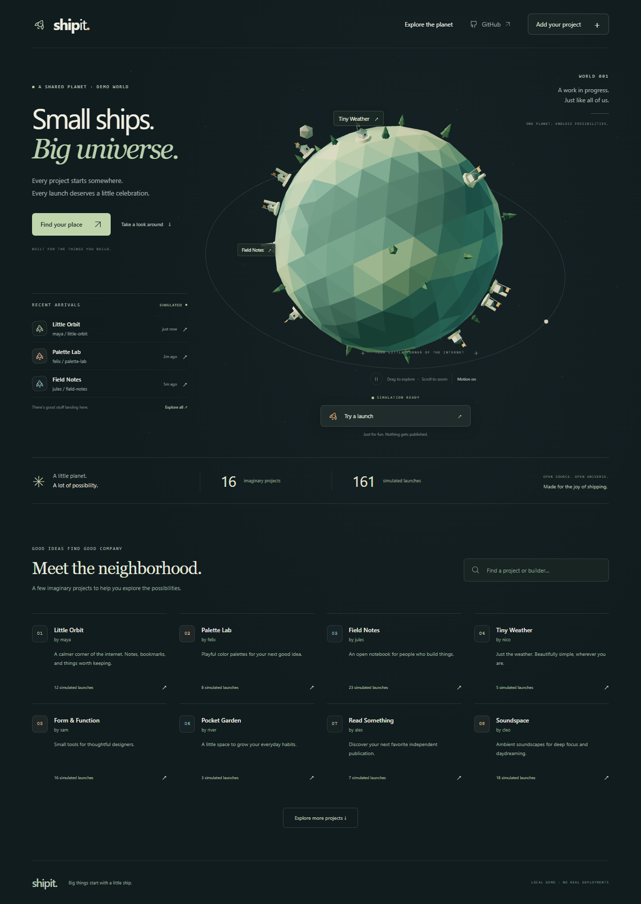

# Ship It

**A successful deployment becomes a rocket launch on one shared planet.**

[Explore the planet](https://ndunl075.github.io/Ship-It/) · [Try a simulated launch](https://ndunl075.github.io/Ship-It/?demo=1&launch=sim-0-0) · [Setup guide](docs/SETUP.md) · [API](docs/API.md)

Ship It gives each public GitHub repository a deterministic landing site. Later production deployments return to that same spot. Explore projects, replay an arrival, inspect deployment history, and share an exact launch URL. No Ship It account, adopter API key, paid AI API, or mandatory paid service.



## Add a rocket to your deploy

Your provider must create a **public GitHub deployment** with a recent successful `production` status. Add [the deployment-status workflow](examples/deployment-status.yml), which pins a tested full commit. The essential step is:

```yaml
- uses: ndunl075/Ship-It@10b9f01ae16a6f73f193fb84000e9b430e1d8231
  continue-on-error: true
  with:
    deployment_id: ${{ github.event.deployment.id }}
    api_url: https://ship-it-api.coform.workers.dev
```

Grant the calling job `contents: read` and `id-token: write`, and run it only after production success. The Action returns `launch_id`, `launch_url`, and `registered`, and writes a share link in the job summary. Replaying the same deployment returns the original launch.

If your provider does not emit deployment-status workflows, use the [final-step template](examples/final-step.yml) after your existing deploy confirms success and has a real deployment ID. Events created with `GITHUB_TOKEN` generally do not trigger another workflow; the final-step integration covers that case. Unsupported providers without GitHub Deployment records need an explicit integration.

“Verified” means **GitHub reported a successful public deployment**. It is not independent proof of uptime, site safety, or provider security. Failed, staging, preview, private, mismatched and stale deployments are rejected. Ship It errors never roll back or fail the primary deployment.

## Develop locally

Use Node 22 and pnpm 10.28.2:

```sh
corepack enable
pnpm install --frozen-lockfile
pnpm db:migrate:local
pnpm dev
```

Open `http://localhost:5173/Ship-It/`. With no API origin configured, the clearly labeled demo uses invented fixture projects and client-only simulations. Nothing is persisted. To use the real API, copy `apps/web/.env.example` to `.env.local`, set `VITE_API_ORIGIN`, and disable `VITE_DEMO_MODE`. Use `?demo=1` for the sandbox at any time.

```sh
pnpm lint
pnpm typecheck
pnpm test
pnpm build
pnpm check:yaml
pnpm exec playwright install chromium
pnpm test:e2e
```

The React/TypeScript/Vite frontend lazily loads its Three.js scene. A Cloudflare Worker verifies GitHub OIDC signatures and REST deployment records, then writes atomically to D1. Visitors use read-only public endpoints. Keyboard navigation, reduced motion, mobile layout and a non-WebGL directory keep the experience usable.

## Host, operate and contribute

GitHub Pages hosts the static app; the Worker and D1 use Cloudflare’s free offerings. Quotas can cause unavailability: this is not unlimited hosting. Deployment does not automatically enable paid plans. Read [SETUP](docs/SETUP.md), [SECURITY](docs/SECURITY.md), [OPERATIONS](docs/OPERATIONS.md), [contributor guidance](CONTRIBUTING.md), and the [implementation evidence](docs/IMPLEMENTATION.md).

Report bugs or request project removal through the repository issue templates. Report sensitive vulnerabilities through GitHub’s private security reporting. Maintainers can hide/unhide projects with an audited operator CLI; there is no public administrator route.

The full [architecture](ARCHITECTURE.md) documents the v1 contracts and boundaries. MIT licensed. No analytics SDK, external map service, AI inference, private-repository access, or required paid subscription.
